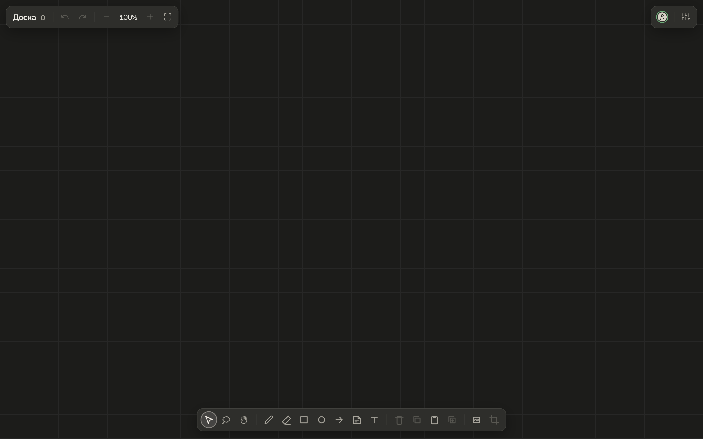
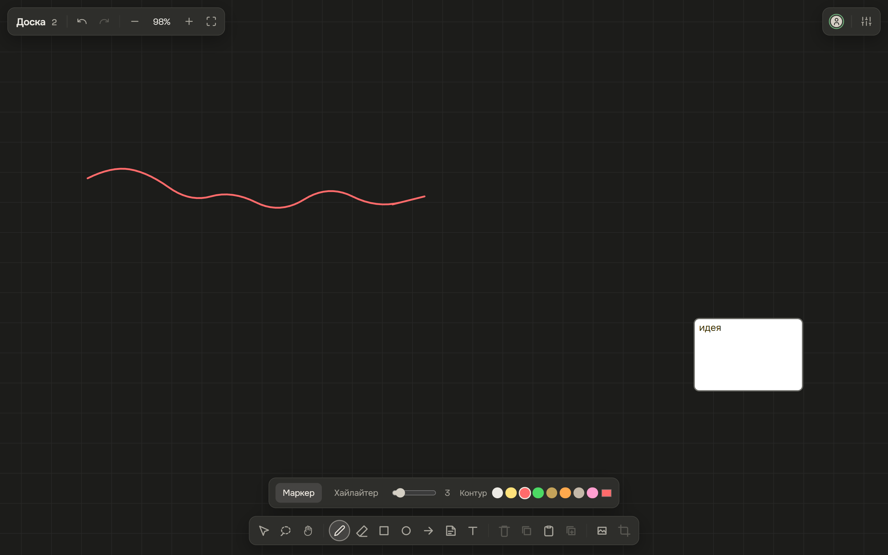
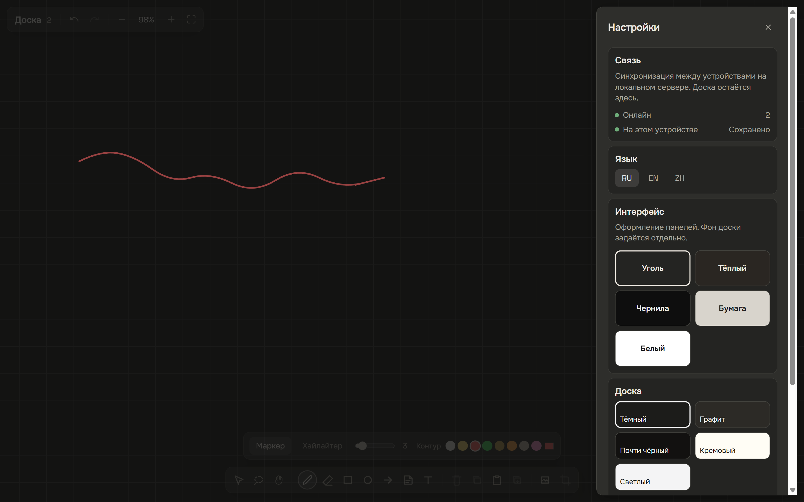

# ReView

[English](README.md) · [Русский](README.ru.md) · [中文](README.zh.md)

本地无限画板。马克笔、便利贴、文字、图片。断网也能用。实时协作是点对点的：画板通过 WebRTC 直接在设备之间传输，只保存在这些设备上。自行托管：一个小程序 `review-host` 或桌面应用。主机只提供界面并介绍节点，从不保存或转发画板数据。

产品名为 ReView。界面上的名字可以在页眉点击重命名。



## 功能

- 马克笔、荧光笔、橡皮（整对象或线段局部）
- 矩形、椭圆、箭头、便利贴、文字
- 图片：文件、粘贴、拖放、裁剪
- 撤销 / 重做、图层顺序、锁定、套索、框选
- IndexedDB 持久化（`review-v1-<id>`）
- 点对点同步（Yjs 走 WebRTC 数据通道），P2P 面板显示每条连接的路径（局域网、直连、TURN）、延迟和流量
- 用 `review-host` 自行托管：界面、无状态信令中继、局域网发现（mDNS）
- 桌面应用（Tauri 2）：为同一 Wi‑Fi 的好友托管，并把画板保存为文件
- 界面语言：俄语（默认）、英语、中文
- 面板外观和画纸背景是两套设置



## 运行

需要 Node 20+。

```bash
npm install
npm run dev
```

Vite 应用在 [http://localhost:5173](http://localhost:5173)，`review-host`（信令中继）在 `:1234`。打开页面，画几笔，刷新后画板还在。

两个浏览器（或局域网里用你的 IP 而不是 `localhost` 的另一台设备）打开同一个 `/board/<id>` 会直接互连，画板在浏览器之间传输。

正式托管（界面和中继在同一端口）：

```bash
npm run host        # http://<lan-ip>:1234/
```

桌面应用：`npm run desktop` / `npm run desktop:build`，见 [docs/DESKTOP.md](docs/DESKTOP.md)。托管、Tailscale、VPS、STUN/TURN：[docs/DEPLOY.md](docs/DEPLOY.md)。

`localhost` 和 `127.0.0.1` 是不同 origin。IndexedDB 不会跟着你换地址。选定一个用到底。

```bash
npm test
npm run build
```



## 布局

界面以岛屿浮在铺满屏幕的画布上。左上是文件岛（名称、撤销、缩放）。右上是在线状态和设置。底部居中是工具带。当前工具或选中对象需要样式时，样式岛会出现在工具带上方。连接和保存文案在设置面板里。

## 许可

Apache License 2.0。见 [LICENSE](LICENSE)。
